# 阅读记录

> 自动同步自私有读书记录仓库，每日更新。  ·  书籍 **29** 本（已读 **6**）  ·  书评 **4** 篇  ·  累计阅读约 **40** 小时  ·  更新于 2026-11-09 07:56 UTC

## 封面墙

共 29 本 · 点击封面可查看大图

<table>
<tr>
<td align="center" valign="top" width="16%"> 强风吹拂（影视） 已读</td>
<td align="center" valign="top" width="16%"><a href="covers/bk_002.jpg">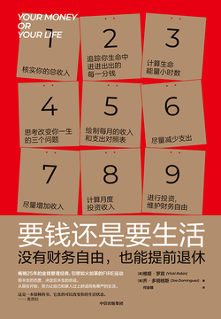</a> 要钱还是要生活 在读</td>
<td align="center" valign="top" width="16%"><a href="covers/bk_003.jpg">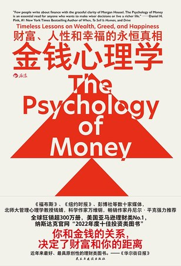</a> 金钱心理学 已读</td>
<td align="center" valign="top" width="16%"> 道德经 弃读</td>
<td align="center" valign="top" width="16%"><a href="covers/bk_005.jpg">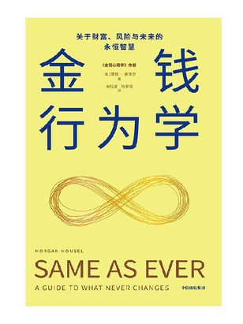</a> 金钱行为学（一如既往） 在读</td>
<td align="center" valign="top" width="16%"><a href="covers/bk_006.jpg">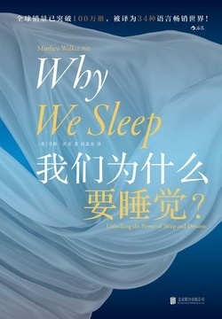</a> 我们为什么要睡觉？ 在读</td>
</tr>
<tr>
<td align="center" valign="top" width="16%"> 世界尽头的咖啡馆 已读</td>
<td align="center" valign="top" width="16%"><a href="covers/bk_008.jpg">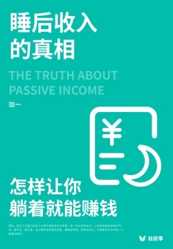</a> 睡后收入的真相：怎样让… 已读</td>
<td align="center" valign="top" width="16%"><a href="covers/bk_009.jpg">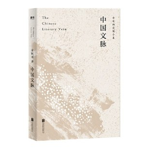</a> 中国文脉 弃读</td>
<td align="center" valign="top" width="16%"> 每天半小时读懂《菜根谭》 弃读</td>
<td align="center" valign="top" width="16%"> 性的屈服者 已读</td>
<td align="center" valign="top" width="16%"> 168间歇性断食 在读</td>
</tr>
<tr>
<td align="center" valign="top" width="16%"><a href="covers/bk_013.jpg">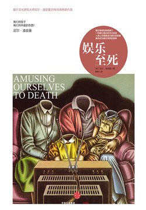</a> 娱乐至死 在读</td>
<td align="center" valign="top" width="16%"><a href="covers/bk_014.jpg">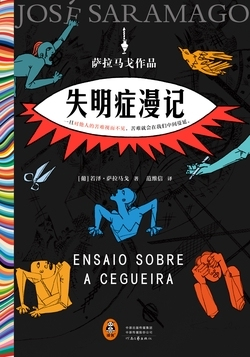</a> 失明症漫记（罗翔推荐） 在读</td>
<td align="center" valign="top" width="16%"><a href="covers/bk_015.jpg">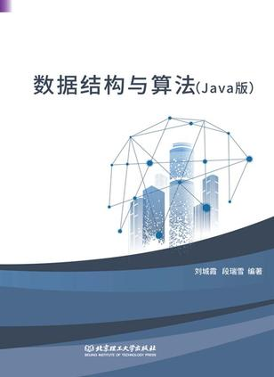</a> 数据结构与算法：Jav… 在读</td>
<td align="center" valign="top" width="16%"> 当人什么都不想要，就拥… 已读</td>
<td align="center" valign="top" width="16%"><a href="covers/bk_017.jpg">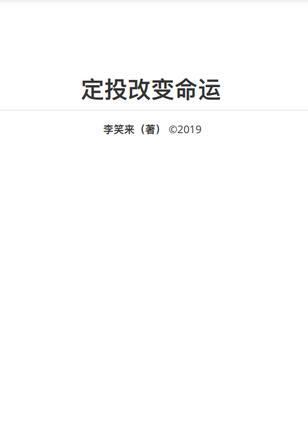</a> 定投改变命运 弃读</td>
<td align="center" valign="top" width="16%"><a href="covers/bk_018.webp">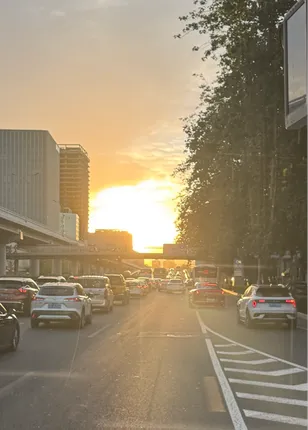</a> 签到 在读</td>
</tr>
<tr>
<td align="center" valign="top" width="16%"> 灵犬莱西 弃读</td>
<td align="center" valign="top" width="16%"><a href="covers/bk_020.jpg">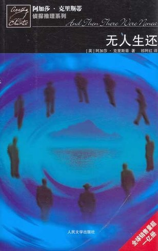</a> 无人生还 想读</td>
<td align="center" valign="top" width="16%"><a href="covers/bk_021.jpg">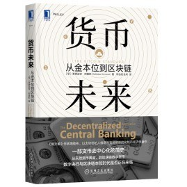</a> 货币未来：从金本位到区… 想读</td>
<td align="center" valign="top" width="16%"><a href="covers/bk_022.jpg">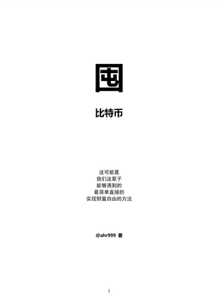</a> 囤比特币 弃读</td>
<td align="center" valign="top" width="16%"> 红岩 想读</td>
<td align="center" valign="top" width="16%"><a href="covers/bk_024.jpg">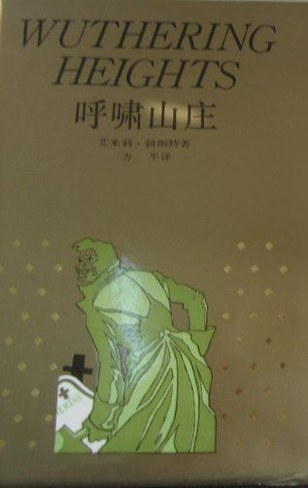</a> 呼啸山庄 想读</td>
</tr>
<tr>
<td align="center" valign="top" width="16%"><a href="covers/bk_025.jpg">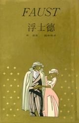</a> 浮士德 想读</td>
<td align="center" valign="top" width="16%"> 百年孤独 想读</td>
<td align="center" valign="top" width="16%"> 当我谈跑步时，我谈些什么 想读</td>
<td align="center" valign="top" width="16%"><a href="covers/bk_028.jpg">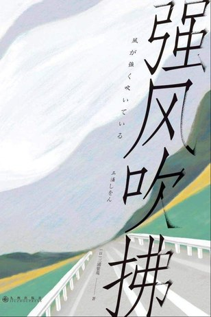</a> 强风吹拂 想读</td>
<td align="center" valign="top" width="16%"> 西游记（全二册） 想读</td>
<td></td>
</tr>
</table>

| 封面 | 书名 | 作者 | 评分 | 状态 | 分类 | 阅读日期 | 书评 |
| --- | --- | --- | --- | --- | --- | --- | --- |
|  | 强风吹拂（影视） | — | ★★★★★ 5.0/5 | 已读 | 影视戏剧 | — | ▸ 见下 |
|  | 要钱还是要生活 | 维姬·罗宾 乔·多明格斯 | 未评 | 在读 | 认知思维 | — | — |
|  | 金钱心理学 | [美]摩根·豪泽尔 | ★★★★★ (10.0) | 已读 | 财经通识 | — | ▸ 见下 |
|  | 道德经 | 张景、张松辉 译注 | 未评 | 弃读 | 中国哲学 | — | — |
|  | 金钱行为学（一如既往） | [美]摩根·豪泽尔 | 未评 | 在读 | 认知思维 | — | — |
|  | 我们为什么要睡觉？ | 马修·沃克 | 未评 | 在读 | 科学科普 | — | — |
|  | 世界尽头的咖啡馆 | [美]约翰·史崔勒基 | ★★★★★ 5.0/5 | 已读 | 人生哲学 | — | ▸ 见下 |
|  | 睡后收入的真相：怎样让你躺着就能赚钱 | 珈一 | ★★★★★ (9.0) | 已读 | 投资理财 | — | — |
|  | 中国文脉 | 余秋雨 | 未评 | 弃读 | 现当代文学 | — | — |
|  | 每天半小时读懂《菜根谭》 | 张乾栋 编著 | 未评 | 弃读 | 中国哲学 | — | — |
|  | 性的屈服者 | 张资平 | ★★★★★ 5.0/5 | 已读 | 现当代文学 | — | ▸ 见下 |
|  | 168间歇性断食 | 冯子新 伊芙·迈耶 梅根·拉莫斯 | 未评 | 在读 | 健康科普 | — | — |
|  | 娱乐至死 | 尼尔·波兹曼 | 未评 | 在读 | 传播与媒体 | — | — |
|  | 失明症漫记（罗翔推荐） | 若泽·萨拉马戈 | 未评 | 在读 | 外国文学 | — | — |
|  | 数据结构与算法：Java版 | 刘城霞，段瑞雪 编著 | 未评 | 在读 | 编程开发 | — | — |
|  | 当人什么都不想要，就拥有了一切（轻游记） | 猴面包的树 | ★★★★☆ 4.0/5 | 已读 | 纪实文学 | — | — |
|  | 定投改变命运 | 李笑来 | 未评 | 弃读 | 投资理财 | — | — |
|  | 签到 | — | 未评 | 在读 | — | — | — |
|  | 灵犬莱西 | [美]艾里克·奈特 | 未评 | 弃读 | 儿童文学 | — | — |
|  | 无人生还 | [英]阿加莎·克里斯蒂 | 未评 | 想读 | 外国文学 | — | — |
|  | 货币未来：从金本位到区块链 | [黎]赛费迪安·阿莫斯（SaifedeanAmmous） | 未评 | 想读 | 金融学 | — | — |
|  | 囤比特币 | ahr999 | 未评 | 弃读 | 投资理财 | — | — |
|  | 红岩 | 罗广斌 | 未评 | 想读 | 社会现实 | — | — |
|  | 呼啸山庄 | [英]艾米莉·勃朗特 | 未评 | 想读 | 外国文学 | — | — |
|  | 浮士德 | （德）歌德 | 未评 | 想读 | 外国文学 | — | — |
|  | 百年孤独 | [哥伦比亚]加西亚·马尔克斯 | 未评 | 想读 | 外国文学 | — | — |
|  | 当我谈跑步时，我谈些什么 | [日] 村上春树 | 未评 | 想读 | 散文杂文 | — | — |
|  | 强风吹拂 | [日] 三浦紫苑 | 未评 | 想读 | 跑步与耐力运动 | — | — |
|  | 西游记（全二册） | 吴承恩 | 未评 | 想读 | 中国古典文学 | — | — |

## 书评

<b>《强风吹拂（影视）》</b> — — · ★★★★★ 5.0/5 · 已读

人生唯一一部动漫

<b>《金钱心理学》</b> — [美]摩根·豪泽尔 · ★★★★★ (10.0) · 已读

不要试图挑战市场，接受平庸的现状

<b>《世界尽头的咖啡馆》</b> — [美]约翰·史崔勒基 · ★★★★★ 5.0/5 · 已读

自此重拾阅读

<b>《性的屈服者》</b> — 张资平 · ★★★★★ 5.0/5 · 已读

何以获得爱情

---
_本页由 GitHub Action 自动生成，请勿手动编辑；读书记录在私有仓库 yuedujilu_backup 中维护。_
