# 书架 · 未读完

> 共 **23** 本（在读 **8** · 弃读 **6** · 想读 **9**）  ·  更新于 2026-11-09 08:23 UTC

主页面 [README.md](README.md) 只展示已读完的书与书评；这里是还没读完的书架。

## 封面墙

共 23 本 · 点击封面可查看大图

<table>
<tr>
<td align="center" valign="top" width="16%"><a href="https://raw.githubusercontent.com/SayangChun/Reading/main/covers/bk_002.jpg">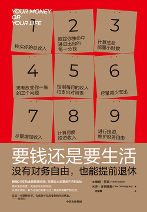</a> 要钱还是要生活 在读</td>
<td align="center" valign="top" width="16%"> 道德经 弃读</td>
<td align="center" valign="top" width="16%"><a href="https://raw.githubusercontent.com/SayangChun/Reading/main/covers/bk_005.jpg">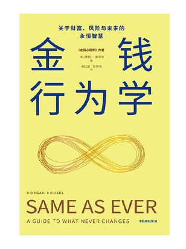</a> 金钱行为学（一如既往） 在读</td>
<td align="center" valign="top" width="16%"> 我们为什么要睡觉？ 在读</td>
<td align="center" valign="top" width="16%"> 中国文脉 弃读</td>
<td align="center" valign="top" width="16%"><a href="https://raw.githubusercontent.com/SayangChun/Reading/main/covers/bk_010.jpg">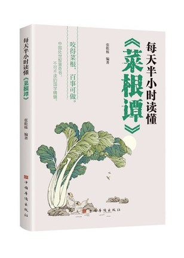</a> 每天半小时读懂《菜根谭》 弃读</td>
</tr>
<tr>
<td align="center" valign="top" width="16%"> 168间歇性断食 在读</td>
<td align="center" valign="top" width="16%"><a href="https://raw.githubusercontent.com/SayangChun/Reading/main/covers/bk_013.jpg">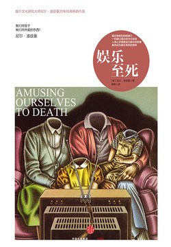</a> 娱乐至死 在读</td>
<td align="center" valign="top" width="16%"><a href="https://raw.githubusercontent.com/SayangChun/Reading/main/covers/bk_014.jpg">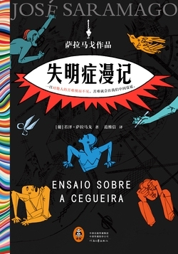</a> 失明症漫记（罗翔推荐） 在读</td>
<td align="center" valign="top" width="16%"><a href="https://raw.githubusercontent.com/SayangChun/Reading/main/covers/bk_015.jpg">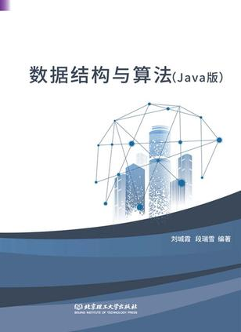</a> 数据结构与算法：Jav… 在读</td>
<td align="center" valign="top" width="16%"><a href="https://raw.githubusercontent.com/SayangChun/Reading/main/covers/bk_017.jpg">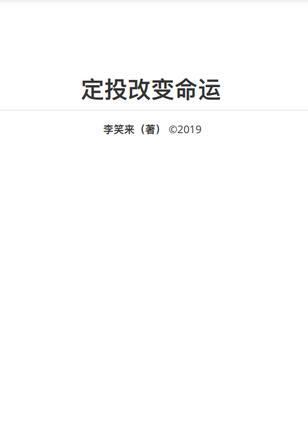</a> 定投改变命运 弃读</td>
<td align="center" valign="top" width="16%"> 签到 在读</td>
</tr>
<tr>
<td align="center" valign="top" width="16%"> 灵犬莱西 弃读</td>
<td align="center" valign="top" width="16%"><a href="https://raw.githubusercontent.com/SayangChun/Reading/main/covers/bk_020.jpg">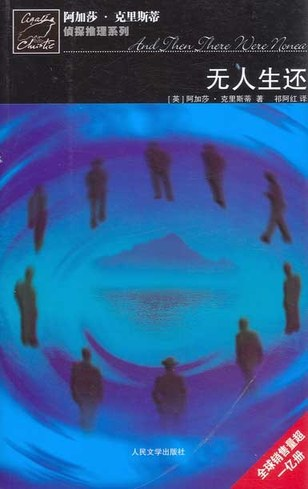</a> 无人生还 想读</td>
<td align="center" valign="top" width="16%"> 货币未来：从金本位到区… 想读</td>
<td align="center" valign="top" width="16%"><a href="https://raw.githubusercontent.com/SayangChun/Reading/main/covers/bk_022.jpg">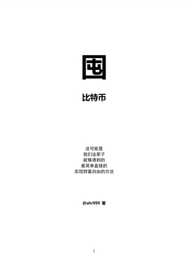</a> 囤比特币 弃读</td>
<td align="center" valign="top" width="16%"> 红岩 想读</td>
<td align="center" valign="top" width="16%"><a href="https://raw.githubusercontent.com/SayangChun/Reading/main/covers/bk_024.jpg">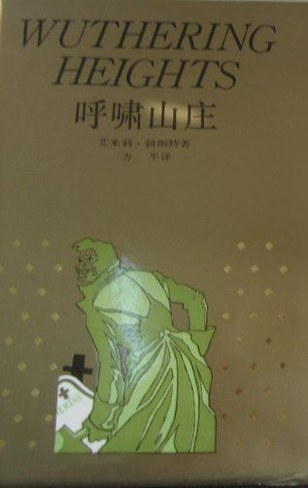</a> 呼啸山庄 想读</td>
</tr>
<tr>
<td align="center" valign="top" width="16%"><a href="https://raw.githubusercontent.com/SayangChun/Reading/main/covers/bk_025.jpg">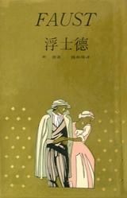</a> 浮士德 想读</td>
<td align="center" valign="top" width="16%"> 百年孤独 想读</td>
<td align="center" valign="top" width="16%"> 当我谈跑步时，我谈些什么 想读</td>
<td align="center" valign="top" width="16%"><a href="https://raw.githubusercontent.com/SayangChun/Reading/main/covers/bk_028.jpg">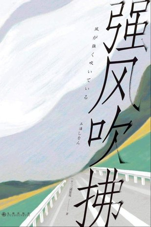</a> 强风吹拂 想读</td>
<td align="center" valign="top" width="16%"> 西游记（全二册） 想读</td>
<td></td>
</tr>
</table>

| 封面 | 书名 | 作者 | 状态 | 分类 |
| --- | --- | --- | --- | --- |
|  | 要钱还是要生活 | 维姬·罗宾 乔·多明格斯 | 在读 | 认知思维 |
|  | 道德经 | 张景、张松辉 译注 | 弃读 | 中国哲学 |
|  | 金钱行为学（一如既往） | [美]摩根·豪泽尔 | 在读 | 认知思维 |
|  | 我们为什么要睡觉？ | 马修·沃克 | 在读 | 科学科普 |
|  | 中国文脉 | 余秋雨 | 弃读 | 现当代文学 |
|  | 每天半小时读懂《菜根谭》 | 张乾栋 编著 | 弃读 | 中国哲学 |
|  | 168间歇性断食 | 冯子新 伊芙·迈耶 梅根·拉莫斯 | 在读 | 健康科普 |
|  | 娱乐至死 | 尼尔·波兹曼 | 在读 | 传播与媒体 |
|  | 失明症漫记（罗翔推荐） | 若泽·萨拉马戈 | 在读 | 外国文学 |
|  | 数据结构与算法：Java版 | 刘城霞，段瑞雪 编著 | 在读 | 编程开发 |
|  | 定投改变命运 | 李笑来 | 弃读 | 投资理财 |
|  | 签到 | — | 在读 | — |
|  | 灵犬莱西 | [美]艾里克·奈特 | 弃读 | 儿童文学 |
|  | 无人生还 | [英]阿加莎·克里斯蒂 | 想读 | 外国文学 |
|  | 货币未来：从金本位到区块链 | [黎]赛费迪安·阿莫斯（SaifedeanAmmous） | 想读 | 金融学 |
|  | 囤比特币 | ahr999 | 弃读 | 投资理财 |
|  | 红岩 | 罗广斌 | 想读 | 社会现实 |
|  | 呼啸山庄 | [英]艾米莉·勃朗特 | 想读 | 外国文学 |
|  | 浮士德 | （德）歌德 | 想读 | 外国文学 |
|  | 百年孤独 | [哥伦比亚]加西亚·马尔克斯 | 想读 | 外国文学 |
|  | 当我谈跑步时，我谈些什么 | [日] 村上春树 | 想读 | 散文杂文 |
|  | 强风吹拂 | [日] 三浦紫苑 | 想读 | 跑步与耐力运动 |
|  | 西游记（全二册） | 吴承恩 | 想读 | 中国古典文学 |

---
_本页由 GitHub Action 自动生成，请勿手动编辑。_
